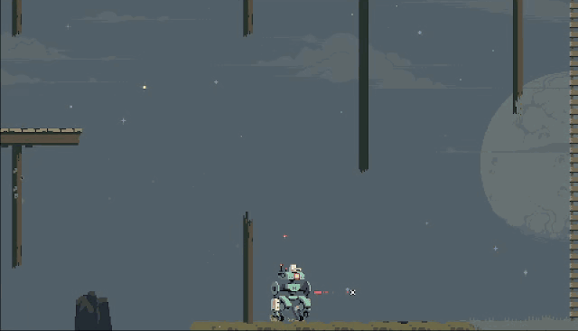
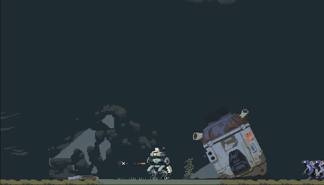
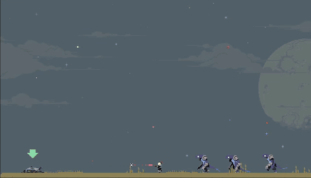
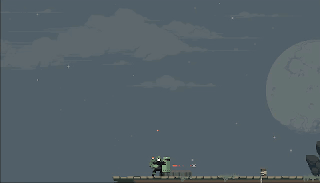
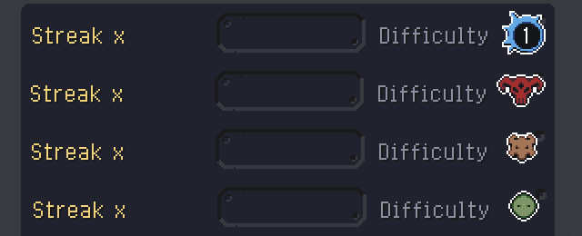
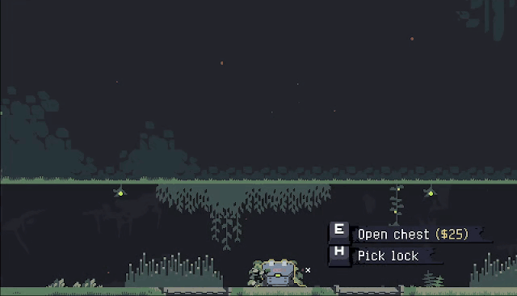
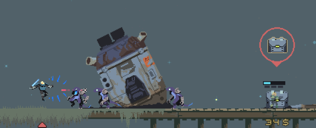

Pick chest locks instead of paying for them. Every chest has a lockpicking minigame: beat it and the chest opens for free. Mistakes make the chest pricier, and the third one breaks the lock and costs you gold.

Full rules and numbers are on the [wiki](https://github.com/GreenAlen22/rorr-LocksUnlocked/wiki).

---
## How it works
Walk up to a chest. Under "Open chest" you get a second prompt, "Pick lock": F by default, D-pad up on a gamepad. Rebind it in Game settings > Mods tab.

While you pick, you stand still and turn half see-through, as with Bandit's Smokebomb, and enemies lose track of you. Your health does not regenerate, but your drones and turrets keep fighting.

Press the key again to stop. Stopping is free, but mistakes stay on the chest, and so does the price they added. The same chest always gives the same minigame.

Robomando - Re-wire starts the same minigame instead of opening things on the spot. His lock is one level easier, his mistakes make no noise and don't raise the price, and a broken lock costs him no gold. Re-wire is also the only way to pick drones and other paid machines.

---
## Results
| Result | When | What you get |
|---|---|---|
| Clean pick | no mistakes on this chest | free chest and a chance at a better item |
| Pick | 1 or 2 mistakes | free chest |
| Broken lock | 3rd mistake | you lose 15% of your gold, the chest can only be bought |

Better item - 20% on small chests (mostly a green item, sometimes red), 8% on large chests (a red item). The Equipment Barrel, Adaptive Chest, Gun Chest and Legendary Chest add this chance to a double drop instead.  
Streak - every successful pick in a row gives +5% chance to drop two items, up to 30%. A broken lock halves the streak.  
Mistakes - each one raises the chest's price by a third of a markup. The markup is 50% of the chest's price at the start of a run and grows by 10% every 3 minutes, up to 150%. A mistake also makes noise: you are visible for a moment and nearby enemies come for you.  
Time limit - when it runs out, that counts as a mistake and the timer starts over.

| Chests | Lock | Time limit |
|---|:--:|:--:|
| Chest, Chest - Damage / Healing / Utility, Equipment Barrel | 1, Drizzle | 20 s |
| Large Chest, Large Chest - Damage / Healing / Utility, Adaptive Chest | 2, Rainstorm | 25 s |
| Gun Chest | 3, Monsoon | 30 s |
| Legendary Chest | 4, Eclipse | 40 s |

---
## Minigames
Pins - pins bob up and down. Set each one when its top is on the gold line.  
Ring - a marker runs around a circle. Press when it is inside a sector.  
Lockpick - move the pick and hold to turn the lock. If the pick shakes, let go or it snaps.  
Pressure - hold to build pressure, let go in the green zone.  
Cipher - arrows flash one by one. Repeat them.  
Circuit - rotate tiles to lead the current to the gold exit before the fuse burns out.  
Probe - steer the probe through laser walls with moving gaps.  
Frequency - match your wave to the target wave and lock it in.  
Code - guess a code of symbols from hints. The first tries are free.

A higher lock level makes each minigame harder. All nine, with what changes at each level, are on the [wiki](https://github.com/GreenAlen22/rorr-LocksUnlocked/wiki).

---
## Multiplayer
Only one player can pick a chest at a time. Everyone else sees a progress bar and the mistakes above the picker's head. A broken lock takes gold only from the player who picked it.

---
## Credits
* GreenAlen22 - Programming, Ideas
* Loudov - Programming
* i7et5 - Design, Ideas, Balance 

## Contacts
My discord: greenalen22  
If something does not work, please write to me on Discord.